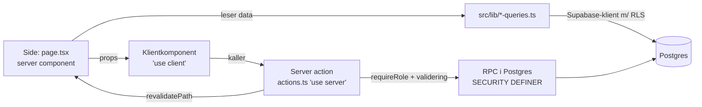
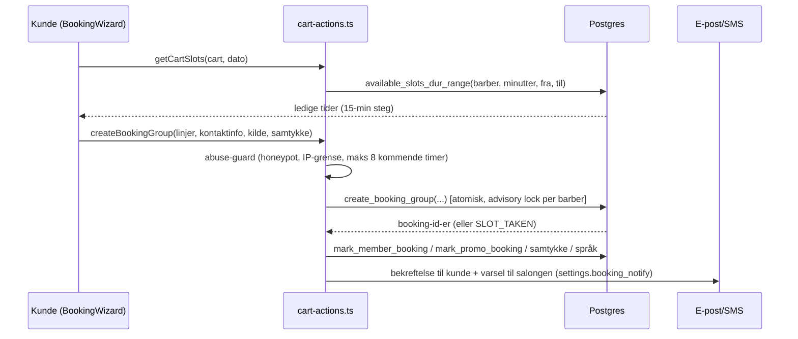
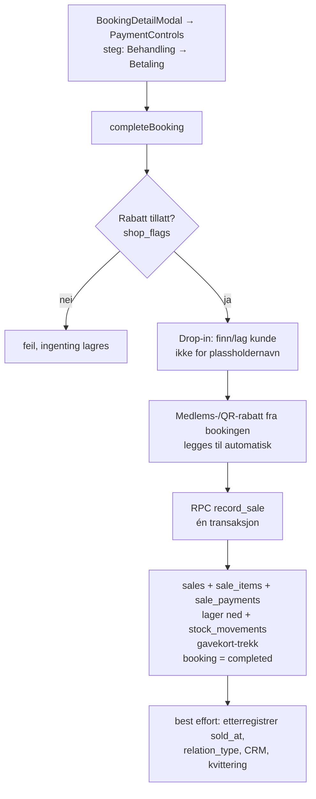
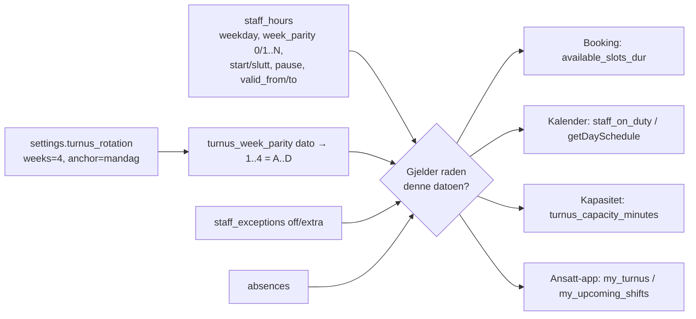

# Downtown Barbers – systemoversikt for utviklere (og Claude Code)

> **Les dette først.** Dette dokumentet forklarer hele plattformen fra bunnen av: hva den gjør,
> hvordan informasjonen flyter, hvor hver input havner, og hvordan delene henger sammen.
> Det er skrevet for en utvikler (eller en AI-agent) som ikke kan noe om prosjektet fra før.
> Sist oppdatert: 10. november 2026 (commit `e1d776f`).
>
> Kortversjonen med arbeidsregler står i `CLAUDE.md` i roten. Detaljer står her.

---

## Innhold

1. [Hva systemet er](#1-hva-systemet-er)
2. [Stack, miljøer og kontoer](#2-stack-miljøer-og-kontoer)
3. [Arkitektur – slik er koden bygget](#3-arkitektur--slik-er-koden-bygget)
4. [Innlogging og roller](#4-innlogging-og-roller)
5. [Databasen](#5-databasen)
6. [Kundesiden og booking](#6-kundesiden-og-booking)
7. [Nettbutikken](#7-nettbutikken)
8. [Kassa (POS)](#8-kassa-pos)
9. [Kasseoppgjør og Fixit-import](#9-kasseoppgjør-og-fixit-import)
10. [Ansatte, turnus, fravær og stempling](#10-ansatte-turnus-fravær-og-stempling)
11. [Lønn](#11-lønn)
12. [Rapporter, nøkkeltall og regnskap (Tripletex)](#12-rapporter-nøkkeltall-og-regnskap-tripletex)
13. [Kunder, markedsføring, e-post og SMS](#13-kunder-markedsføring-e-post-og-sms)
14. [Revisor-portalen](#14-revisor-portalen)
15. [Ansatt-appen (iPhone/Android)](#15-ansatt-appen-iphoneandroid)
16. [Nettsideinnhold, språk og SEO](#16-nettsideinnhold-språk-og-seo)
17. [Integrasjoner og miljøvariabler](#17-integrasjoner-og-miljøvariabler)
18. [Cron-jobber og API-ruter](#18-cron-jobber-og-api-ruter)
19. [UI-system og stil](#19-ui-system-og-stil)
20. [Tester og verifisering](#20-tester-og-verifisering)
21. [Arbeidsregler – slik bygger du videre](#21-arbeidsregler--slik-bygger-du-videre)
22. [Kjente problemer, teknisk gjeld og åpne oppgaver](#22-kjente-problemer-teknisk-gjeld-og-åpne-oppgaver)
23. [Ordliste](#23-ordliste)

---

## 1. Hva systemet er

**Downtown Barbers AS** er en barbersalong i Oslo sentrum (åpnet 2013, åpent man–lør kl. 10–20).
Denne plattformen **erstatter kassesystemet Fixit** (fixitonline.no) og samler alt salongen trenger:

| Del | Hvem bruker den | Hvor |
|---|---|---|
| Nettside + booking | Kunder | `/`, `/booking` |
| Kundeportal ("Min side") | Kunder | `/min-side/<token>` |
| Nettbutikk | Kunder | `/butikk` |
| Kassa / POS på iPad | Skranke (rolle `shop`) | `/kasse` |
| Back-office | Admin og eier | `/admin` |
| Ansattportal + app | Barbere (rolle `staff`) | `/ansatt` + appen «DTB Ansatt» |
| Revisorportal | Regnskapsfører (rolle `revisor`) | `/revisor` |

**Personer du vil møte i data og kommentarer:**
- **Dawit** – eier (rolle `eier`). I ansattabellen heter han **«David»**. Han er også barber.
- **Kidus** – konsulent/prosjektleder som bestiller utviklingen. Skriver norsk.
- **Kumar** – revisor/regnskapsfører (bruker revisor-portalen og Tripletex).
- **Kochari** – barber + markedsføringsansvarlig, fastlønn.
- **Toni (Antonio Moysa)** og **Riccardo** – barbere (nye ansatte høsten 2026).
- Tidligere barbere: Vani, Soren, Qasim, Mehetabel (inaktive – historikken deres skal stå).

**Forretningsregler som går igjen i koden:**
- Åpningstid man–lør 10–20 (søndag stengt). Kilden er `site_settings.hours` i databasen.
- Lønnsmodell (standard): grunnlønn 27 000 kr/mnd + **40 % provisjon av omsetning eks. mva over 72 000 kr**.
  Kochari har 15 000 kr fastlønn uten provisjon. Satser kan overstyres per ansatt.
- Alle priser i databasen er **inkl. 25 % mva**. Eks. mva = beløp ÷ 1,25.
- Kortbetalinger går gjennom en egen leid kortterminal (ikke integrert). Kassa *registrerer* betalingsmåten.
  Vipps brukes både i kassa (polling) og på nett.
- Overgang fra Fixit: kassa i nytt system ble tatt i bruk ca. **5.–6. oktober 2026**. Data før det ligger
  i Fixit og er delvis importert (historikk, kunder, kasseoppgjør).

---

## 2. Stack, miljøer og kontoer

| Ting | Verdi |
|---|---|
| Rammeverk | **Next.js 16.3.2** (App Router), React 19.2, TypeScript (strict) |
| Stil | Tailwind CSS v4 + egne OKLCH-tokens i `src/app/globals.css` |
| Database/Auth/Storage | **Supabase** (Postgres + RLS). Prosjekt-ref: `kekdspamodouqqeptxwa` |
| Hosting | **Vercel**, team `kidus-girmas-projects` (`team_PlzJkLLQ5xFIUZoMAgHI0ozK`), prosjekt `downtownbarbers` (`prj_dLYTjiTDbYzvN1lkxVgLzGW6Rc5L`), region `dub1` |
| Domene | `downtownbarbers.no` (DNS hos Domeneshop). www → uten www |
| Git | GitHub `Bidusg/Downtownbarbers`, branch `main`. Push til `main` = automatisk deploy i Vercel |
| E-post | Resend (avsenderdomene `downtownbarbers.no` + `nyhetsbrev.downtownbarbers.no` for kampanjer) |
| PDF | `@react-pdf/renderer` (Node runtime) |
| Excel | `exceljs` |
| PDF-lesing | `unpdf` (Fixit-import) |
| Grafer | `recharts` |
| App | Capacitor 7 i `app-ansatt/` |

> ⚠️ **Next.js 16 er ikke den Next.js du kjenner.** `AGENTS.md` sier: les guidene i
> `node_modules/next/dist/docs/` før du skriver kode. Eksempler på forskjeller:
> middleware heter nå **`src/proxy.ts`**, `searchParams`/`params` er **Promise** i sider,
> og route-typer genereres med `next typegen` (ellers feiler `tsc` på `LayoutProps`).

**Lokal kjøring**
```bash
npm install
cp .env.example .env.local     # fyll inn Supabase-nøkler (se seksjon 17 for full liste)
npm run dev                    # http://localhost:3000
npx next typegen && npx tsc --noEmit   # typesjekk
npx eslint <filer>             # lint (det finnes kjente gamle lint-feil i BookingWizard, CommandPalette, ansatt/turnus)
```

---

## 3. Arkitektur – slik er koden bygget

### 3.1 Mappestruktur

```
src/
  app/                    ← ruter (App Router). Én mappe = én URL.
    page.tsx              ← forsiden
    booking/              ← bookingflyt (BookingWizard + server actions)
    butikk/               ← nettbutikk
    min-side/             ← kundeportal
    kasse/                ← POS for skranken (rolle shop)
    admin/                ← back-office (admin/eier)
    ansatt/               ← ansattportal (rolle staff)
    revisor/              ← revisorportal
    api/                  ← cron, webhooks, worker
    q/[slug]/             ← QR-tilbud (setter cookie)
  components/
    ui/                   ← designsystem-primitiver (Card, Table, Button, StatTile …)
    admin/ kasse/ ansatt/ revisor/ site/ booking/ shop/ portal/ …
  lib/                    ← all forretningslogikk og dataoppslag
    supabase/             ← klienter (server, browser, public, service)
    salary/               ← lønnsmodulen
    tripletex/            ← regnskapsbro
    pdf/                  ← PDF-generatorer
    xlsx/                 ← Excel-eksport
    i18n/                 ← språk
  proxy.ts                ← «middleware» i Next 16
supabase/migrations/      ← nummererte migreringer 0001–0073 (historikk)
KJØR-I-SUPABASE*.sql      ← SQL som kjøres MANUELT i Supabase (se seksjon 5)
app-ansatt/               ← Capacitor-app (egen pakke, ikke en del av Next-bygget)
docs/                     ← denne dokumentasjonen
```

### 3.2 Mønstrene (viktig å forstå)

Nesten all kode følger det samme mønsteret:



1. **Sider er server components.** De henter data via funksjoner i `src/lib/*` (f.eks. `getPayroll`,
   `getDayAgenda`) og sender det som props til klientkomponenter.
2. **Skriving skjer i server actions** (`actions.ts` med `"use server"`). Hver action:
   - sjekker rolle (`requireRole([...])` eller `getUserRole()` + `isAdminRole`)
   - validerer input på serveren (aldri stol på klienten – f.eks. regnes «forventet» kasse alltid på serveren)
   - kaller enten Supabase direkte eller en **RPC** (Postgres-funksjon)
   - kaller `revalidatePath(...)` så sidene oppdateres
   - returnerer `{ ok: true }` eller `{ error: "norsk feilmelding" }` (kaster sjelden)
3. **Viktige operasjoner er RPC-er** (`security definer`) slik at de er atomiske og håndhever regler
   i databasen: `record_sale`, `create_booking_group`, `edit_cash_settlement` osv.
4. **RLS (Row Level Security) er siste forsvarslinje.** Tabeller har policies som `is_admin()`,
   `is_shop_or_admin()`, `is_admin_or_revisor()`, `current_staff_id()`.
5. **«Degrader trygt»-mønsteret.** SQL kjøres manuelt, så koden må tåle at en kolonne/tabell/RPC
   ikke finnes ennå. Typisk:
   ```ts
   const first = await sb.from("x").select("a, b, ny_kolonne");
   if (first.error) { /* prøv igjen uten ny_kolonne, eller returner tomt/standard */ }
   ```
   eller en feilmelding som `"Kjør KJØR-I-SUPABASE-XYZ.sql i Supabase først."`.
   **Behold dette mønsteret** når du legger til nye kolonner.
6. **Service-klienten** (`createServiceClient()`, omgår RLS) brukes kun på serveren til cron,
   webhooks, kundeinnlogging, SMS-config og enkelte «best effort»-oppdateringer.

### 3.3 Supabase-klientene (`src/lib/supabase/`)

| Fil | Funksjon | Bruk |
|---|---|---|
| `server.ts` | `createClient()` | Standard på serveren. Cookie-basert, anon-nøkkel, **RLS gjelder** |
| `client.ts` | `createClient()` | I nettleseren |
| `public.ts` | `createPublicClient()` | Uten cookies – for `unstable_cache` av offentlige data |
| `service.ts` | `createServiceClient()` | `SUPABASE_SERVICE_ROLE_KEY`, **omgår RLS**. Kun server |

---

## 4. Innlogging og roller

### 4.1 Roller (`src/lib/auth.ts`)

`profiles.role` er en Postgres-ENUM `user_role` med verdiene:

| Rolle | Hvem | Landingsside |
|---|---|---|
| `admin` | Admin (Kidus m.fl.) | `/admin` |
| `eier` | Eier (Dawit) – **likestilt med admin overalt** | `/admin` |
| `shop` | Skranke-iPad | `/kasse` |
| `staff` | Barbere | `/ansatt` |
| `revisor` | Regnskapsfører | `/revisor` |
| `customer` | Standard for alle andre | – |

Funksjoner:
- `getUserRole()` – hvem er innlogget (cachet per request). Returnerer `{ userId, email, role }` eller null.
- `isAdminRole(role)` – sann for `admin` og `eier` (speiler SQL `is_admin()`).
- `requireRole(["admin", "revisor"])` – stopper siden/action. Ikke innlogget → `/?login=1&ansatt=1`,
  feil rolle → `/ingen-tilgang`. `eier` slipper gjennom der `admin` er tillatt.

### 4.2 Hvor rollene håndheves

| Område | Vakt |
|---|---|
| `src/proxy.ts` → `src/lib/supabase/middleware.ts` | `PROTECTED = ["/admin", "/kasse", "/ansatt"]` krever innlogging. **`/revisor` er ikke i lista** – den vaktes av layouten |
| `src/app/admin/layout.tsx` | `isAdminRole` |
| `src/app/kasse/layout.tsx` | `requireRole(["shop","admin"])` |
| `src/app/ansatt/layout.tsx` | `requireRole(["staff","admin"])` |
| `src/app/revisor/layout.tsx` | `requireRole(["revisor","admin"])` |
| Hver server action | sin egen `requireRole` (ikke stol på layouten alene) |
| Databasen | RLS-policies + rollesjekk inni RPC-ene |

### 4.3 Ansatt-innlogging
- Admin oppretter innlogging under Ansatte → «Opprett innlogging» (`createStaffLogin`): lager auth-bruker
  med midlertidig passord via service-klienten, setter `profiles.role='staff'` og `staff.profile_id`.
- `current_staff_id()` i SQL finner ansattraden via `profile_id = auth.uid()` (fallback: e-post).
- **Stemplings-PIN** (4 siffer, `staff.pin_hash`) brukes i kassa for stempling og for å godkjenne flytting
  av kunder mellom barbere.

### 4.4 Kundeinnlogging (IKKE Supabase Auth)
- Kunder logger inn med **engangskode** på e-post/SMS (`src/app/logg-inn/actions.ts`). Koden lagres
  sha256-hashet i `customer_login_codes` (10 min levetid, 5 forsøk, 5 koder/time).
- Etter innlogging settes cookie **`dtb_kunde`** (httpOnly, 1 år) = kundens `portal_token`, og `dtb_kunde_in=1`
  (lesbar for JS, så headeren kan vise «Min side»).
- **Gotcha:** Å åpne en `/min-side/<uuid>`-lenke logger enheten inn i ett år (middleware setter cookien).

---

## 5. Databasen

### 5.1 SQL-filene – slik endres skjemaet (LES DETTE)

Det finnes **ingen automatisk migrering**. Skjemaendringer gjøres slik:

| Fil | Hva det er |
|---|---|
| `supabase/migrations/0001_init.sql` … `0073_*.sql` | Historisk grunnskjema og tidlige endringer. Kjøres **ikke** automatisk |
| `KJØR-I-SUPABASE.sql` | Samlefil (idempotent) for 0024–0071 |
| `KJØR-I-SUPABASE-<NAVN>.sql` (ca. 80 filer i roten) | **Funksjonspatcher.** Limes inn manuelt i Supabase → SQL Editor av Kidus |
| `supabase/setup_all.sql`, `seed.sql` | Oppstart av tom database + grunndata |

**Regler for nye SQL-filer** (alle eksisterende følger dem):
1. Navngi `KJØR-I-SUPABASE-<KORT-NAVN>.sql` i roten.
2. **Idempotent:** `create table if not exists`, `add column if not exists`, `create or replace function`,
   `drop policy if exists` før `create policy`, guardede `do $$ … $$`-blokker.
3. Topp-kommentar på norsk: hva fila gjør, hva den krever (andre filer), «Trygt å kjøre flere ganger».
4. Slutt med `notify pgrst, 'reload schema';` og gjerne en `select` som viser at det virket.
5. Nye `security definer`-funksjoner: **`revoke execute … from public, anon;`** og grant til `authenticated`
   (Postgres gir PUBLIC execute som standard!). Sjekk rolle inni funksjonen.
6. Test lokalt mot Postgres hvis mulig (to ganger, for å bekrefte idempotens).
7. Fortell Kidus **nøyaktig hvilke filer som skal kjøres, og i hvilken rekkefølge**.

Vi vet ikke alltid hvilke filer som faktisk er kjørt i produksjon – derfor «degrader trygt»-mønsteret i koden.

### 5.2 Kjente fallgruver i databasen

| Fallgruve | Hva du gjør |
|---|---|
| **PostgREST returnerer maks 1000 rader** per kall, uansett `.limit(100000)` | Bruk `.range(from, from+999)` i løkke (se `kpi-revenue.ts`, `ops-queries.ts` `getDailyReconciliation`). Bruk `count: "exact", head: true` for antall |
| `booking_status` er ENUM (`pending, confirmed, completed, cancelled, no_show`) | Sammenlign med `status::text`. Aldri `coalesce(status,'')` – gir enum-feil |
| `user_role` er ENUM | Ny verdi: `alter type user_role add value if not exists 'x'` **alene/først**. Sammenlign på `role::text` i funksjoner |
| `staff` er lesbar for anon **kolonne for kolonne** | Ny offentlig kolonne krever `grant select (kolonne) on staff to anon`. Sensitive data (kontonr, lønn) skal **ikke** i `staff` – kassa kan lese den. Bruk `salary_settings` |
| Tidssone | Vercel kjører UTC. Bruk `src/lib/oslo-time.ts` (`osloToUtcISO` m.fl.). Aldri `new Date("YYYY-MM-DDTHH:mm")` |
| Dagsvinduer i kasseoppgjør | `getExpectedByMethodForDate`/`getDailyReconciliation` bruker **UTC-døgn**, mens «i dag»/etterregistrering bruker Oslo-tid. Salg mellom 00:00–02:00 norsk tid havner på feil dag (sjelden i praksis) |

### 5.3 Hovedtabeller per domene

| Domene | Tabeller |
|---|---|
| Identitet/ansatte | `profiles`, `staff`, `staff_levels`, `staff_services`, `staff_service_exclusions` (legacy), `staff_portfolio`, `staff_documents` |
| Turnus/HR | `staff_hours`, `staff_exceptions`, `absences`, `leave_requests`, `shift_events` (stempling), `shifts` |
| Booking | `bookings`, `booking_addons`, `booking_blocks`, `services`, `service_categories`, `service_level_prices`, `ratings`, `followups`, `crisis_requests` |
| Kunder/CRM | `customers`, `customer_barbers`, `customer_login_codes`, `contact_messages`, `marketing_consent_log` |
| Kundeklubb/kampanjer | `membership_tiers`, `member_campaigns`, `member_campaign_redemptions`, `promo_campaigns` |
| Kasse | `sales`, `sale_items`, `sale_payments`, `sale_voids`, `cash_settlements`, `gift_cards`, `gift_card_redemptions` |
| Varer/nettbutikk | `products`, `stock_movements`, `online_orders`, `online_order_items`, `online_order_events` |
| Lønn | `salary_settings`, `salary_period`, `salary_period_lines` |
| Fixit-arv | `historical_staff_revenue`, `fixit_turnover_daily`, `fixit_settlements` |
| Regnskap | `tripletex_account`, `tripletex_balance`, `tripletex_voucher`, `tripletex_posting`, `tripletex_vat_type`, `tripletex_sync_run`, `tripletex_voucher_log`, `vouchers` (bilag), `budgets`, `daily_targets` |
| Meldinger | `marketing_sends`, `marketing_queue`, `sms_config`, `sms_inbound`, `sms_log`, `notices` |
| Nettside/CMS | `settings` (nøkkel/verdi), `site_settings`, `site_texts`, `site_images`, `site_media`, `site_craft`, `site_section_flags`, `content_translations`, `translation_config`, `review_config` |

**Viktige `settings`-nøkler** (tabellen `settings`, kolonne `value` er jsonb):
`turnus_rotation` `{weeks, anchor}`, `shop_flags`, `booking_notify` `{enabled, email}`, `tracking`, `turnus_anchor` (legacy).

**Storage-bøtter:** `site` (offentlig), `staff-files` (offentlig: bilder), **`staff-docs` (privat: kontrakter, lønnsslipper)**,
`documents`, `vouchers`. Private filer åpnes med signerte URL-er (1 time).

### 5.4 SQL-hjelpefunksjoner

| Funksjon | Betydning |
|---|---|
| `is_admin()` | rolle admin eller eier |
| `is_shop_or_admin()` | admin, eier eller shop |
| `is_owner()` | eier |
| `is_admin_or_revisor()` | admin, eier eller revisor |
| `current_staff_id()` | ansatt-id for innlogget bruker |
| `current_role_name()` | rollen til innlogget bruker |
| `turnus_week_parity(date)` | hvilken turnusuke (1=A, 2=B …) en dato er |
| `salon_hours(dow)` | åpningstid for ukedag |

Viktige RPC-er er listet under hvert område nedenfor.

---

## 6. Kundesiden og booking

### 6.1 Offentlige sider

| URL | Fil | Hva |
|---|---|---|
| `/` | `src/app/page.tsx` | Forside. Data: `getPublicServices`, `getPublicBarbers` (`src/lib/queries.ts`), `getSiteSettings`, bilder, nivåpriser, anmeldelser. Kontaktskjema → `src/app/kontakt-actions.ts` |
| `/booking` | `src/app/booking/page.tsx` | Laster alt `BookingWizard` trenger (tjenester, barbere, tillegg, nivåpriser, medlemsprofil, aktivt QR-tilbud) |
| `/booking/bekreftelse` | | Resultat etter Vipps-betaling av booking |
| `/barbere/[slug]` | | Barberprofil + portefølje (`staff_portfolio`) |
| `/min-side/[token]` | | Kundeportal: kommende timer (avbestill/flytt), kjøpshistorikk (PDF), medlemsnivå, nettordrer |
| `/logg-inn` | | Engangskode-innlogging for kunder + innlogging for ansatte |
| `/avbestill/[token]` | | Avbestilling fra e-postlenke (`cancel_booking_by_token`) |
| `/vurder/[id]` | | Kunden gir stjerner etter besøk (`rate_booking`) |
| `/q/[slug]` | route | QR-kode: teller skann (`promo_scan`), setter cookie `dtb_promo`, sender til `/tilbud` |
| `/tilbud` | | Viser QR-tilbudet |
| `/avmeld/[token]` | | Avmelding fra markedsføring |
| `/e/[t]` | route | Viser en e-post i nettleseren på valgt språk |

### 6.2 Bookingflyten (der input går)



**Komponenten:** `src/components/booking/BookingWizard.tsx` (stor fil, ~1700 linjer). Tre steg:
1. **Tjenester** – velg behandling(er), tillegg vises på kortet.
   - Modus **«Bare meg»** (`single`): én tjeneste + tillegg, én barber tar alt etter hverandre.
   - Modus **«Flere personer»** (`group`): én tjeneste per person, hver person kan ha egen barber.
     Alle starter samtidig. Personnavn lagres i `bookings.person_label`.
2. **Tid** – velg barber («Hvem som helst» = `__any__`) → dag → tid. «Finn neste ledige» søker framover.
3. **Bekreft** – kontaktinfo, «Hvordan hørte du om oss?» (lagres alltid på norsk i `customers.source`),
   markedsføringssamtykke, notat.

State huskes i `sessionStorage["dtb-booking-v2"]`, kontaktinfo i `localStorage["dtb-kunde"]`.

**Ledige tider – reglene** (siste versjon i `KJØR-I-SUPABASE-TURNUS-PAUSE.sql`, RPC `available_slots_dur`):
- 15-minutters steg innenfor åpningstid (`salon_hours`).
- Barberen må ha **turnus** (`staff_hours`) den dagen – uten turnus kan barberen **ikke bookes** (unntak: ekstravakt).
- Turnusrad gjelder hvis `weekday` stemmer, `week_parity` er 0 eller lik `turnus_week_parity(dato)`,
  og datoen er innenfor `valid_from`–`valid_to`.
- Pause (`pause_start`–`pause_end`) kan ikke bookes.
- `staff.start_date`/`end_date` begrenser perioden barberen kan bookes.
- `staff_exceptions` `kind='off'` og `absences` fjerner barberen; `kind='extra'` legger til (og vinner).
- `booking_blocks` (hel dag eller tidsvindu) blokkerer alle.
- Kan ikke overlappe eksisterende booking med status pending/confirmed/completed.
- Må være i framtiden.

**Opprettelse** (`createBookingGroup` i `src/app/booking/cart-actions.ts`):
- RPC `create_booking_group` (fra `KJØR-I-SUPABASE-BOOKING-ATOMISK.sql`) er alt-eller-ingenting og tar
  `pg_advisory_xact_lock` per barber. Er tiden tatt → `SLOT_TAKEN` → wizard går tilbake til tidsvalg.
- Fallback hvis RPC mangler: `create_booking_line` per linje.
- **Prisen settes i databasen** etter barberens nivå (`service_level_prices`), ikke fra klienten.
- Etterpå (alt i try/catch, kan aldri angre bookingen): kundeportal-token, avbestillingstoken,
  medlems-/QR-rabatt, språk, samtykke, e-post (`sendBookingConfirmation`), SMS, varsel til salongen.

> **Død kode:** `src/app/booking/actions.ts` (`createBooking`) og `availability-actions.ts` ser ut som
> bookingflyten, men brukes ikke. Den ekte flyten er `cart-actions.ts`.

### 6.3 Priser, rabatter og kampanjer

| Mekanisme | Hvor | Regel |
|---|---|---|
| **Nivåpris** | `staff_levels`, `service_level_prices` (0053) | Pris per tjeneste × barbernivå (junior/barber/senior/master). Fallback `services.price_nok` |
| **Kundeklubb** | `membership_tiers`, RPC `member_profile`, `src/lib/member.ts` | Nivå avledes av forbruk/besøk siste 12 mnd. Gir % på tjenester/varer (ev. bare utenom rush: man–fre før 15) |
| **QR-tilbud** | `promo_campaigns`, `src/lib/promo.ts`, cookie `dtb_promo` (75 dager) | F.eks. KPMG Movember: 20 % på egen klipp, 50 % for venn, 15 % på varer, med frister |
| **Kuponger** | `member_campaigns` | Velges i kassa (`CouponPicker`), valideres i `record_sale` |

**Regel:** medlemsrabatt og QR-rabatt **stables aldri** – den største vinner. Begge lagres i
`bookings.member_tier / member_service_pct / member_product_pct`, og **kassa trekker rabatten automatisk**
når timen fullføres.

### 6.4 Rekkefølge på tjenester og barbere
- Barbere: `staff.sort_order` (Admin → Ansatte → «Rekkefølge på nettsiden», `StaffWebOrder.tsx`).
- Tjenester: `services.sort_order` + `service_categories.sort_order`
  (Admin → Tjenester → «Rekkefølge på tjenester», `ServiceOrder.tsx`, action `saveServiceOrder`).
  Brukes av booking, forside og kasse.

---

## 7. Nettbutikken

- Ruter under `src/app/butikk/**`. Lukket for publikum når `webshop_settings.live=false` (admin ser forhåndsvisning).
- Handlekurv i `localStorage` (`dtb_cart_v1`, `CartProvider.tsx`).
- **Kasse ut** (`placeOrder` i `src/app/butikk/actions.ts`) → RPC **`create_online_order`** (setter pris, lager, frakt, medlemsrabatt).
  - Betaling: **Vipps** (reserveres, trekkes i kassa ved utlevering), kort via Vipps (`VIPPS_CARD_ENABLED=1`),
    eller **betal ved henting**. **Stripe er ikke i bruk** (kun env-variabler i `.env.example`).
  - QR-tilbud: `apply_promo_to_order`.
- Ordreside `/butikk/ordre/[id]?t=<token>` → `online_order_public`.
- Vipps-webhook `src/app/api/vipps/webhook/route.ts` (HMAC-sjekk).
- **Plukk og utlevering skjer i kassa** (seksjon 8.5). Lager reserveres ved bestilling; salget bokføres ved utlevering.
- SQL: `KJØR-I-SUPABASE-NETTBUTIKK.sql`, `-NETTORDRE-PLUKK.sql`, `-NETTORDRE-RETUR.sql`, `-NETTORDRE-TILGODELAPP.sql`.

---

## 8. Kassa (POS)

Rolle `shop` (iPad i salongen). Admin/eier har også tilgang og omgår alle sperrer.

### 8.1 Sider (`src/app/kasse/**`)

| URL | Hva |
|---|---|
| `/kasse` | Kiosk-forside (stemplingstavle, auto-oppdatering) |
| `/kasse/kalender?date=` | **Dagskalenderen** (`DayCalendar.tsx`) – hovedarbeidsflaten |
| `/kasse/kunder`, `/[id]` | Kundesøk, kundekort, klippekort |
| `/kasse/stempling` | Inn/ut-stempling med PIN |
| `/kasse/nettordrer` | Plukk og utlevering av nettordrer |
| `/kasse/kasseoppgjor` | Dagens kasseoppgjør |
| `/kasse/lager` | Strekkodeskanning, varemottak/justering |
| `/kasse/gavekort` | Saldooppslag |
| `/kasse/krisetimer` | Forespørsler om krisetime |
| `/kasse/dokumenter` | Firmadokumenter (personalhåndbok) |

Hovedfil for actions: `src/app/kasse/actions.ts` (~1500 linjer). Layouten viser bannere for
manglende kasseoppgjør, nye nettordrer, krisetimer og interne meldinger.

### 8.2 Dagskalenderen
- Kolonne per barber som er på jobb (eller har timer). Henter `day_agenda`, `staff_on_duty`, turnus, unntak og fravær.
- Bevegelser: dra for lengde (15 min), dra opp/ned for å flytte tid, dra sidelengs til annen barber
  (krever **PIN fra opprinnelig barber**, `reassignBookingBarber` → `verify_pin_status`). Sveip = bytt dag.
- Oppdaterer hvert minutt (pauser mens en dialog er åpen).
- En blokkering/pause er en booking uten kunde og uten tjeneste.
- Actions: `rescheduleBooking`, `setBookingLength`, `changeBookingService`, `blockTime`, `createDeskBooking`,
  `createDropinBooking`, `cancelBooking`, `markNoShow`, `reopenBooking`.
- Passerte timer kan ikke avlyses av kassa – de må markeres «Ikke møtt» (no-show bevares). Admin kan overstyre.

### 8.3 Fullføre en time (salg)



- **`record_sale(p_booking, p_payment_method, p_products, p_discount, p_payments, p_campaign, p_gift_code, p_gift_amount)`**
  – siste definisjon i `KJØR-I-SUPABASE-GAVEKORT-BETALING.sql`. Delbetaling (`p_payments`) må summere til totalen.
  Feiler RPC-en, blir timen **ikke** fullført (salg forsvinner aldri i stillhet).
- **Etterregistrering:** fullføres en time fra en tidligere dag, settes `sales.sold_at` til timens start
  (så salget havner på riktig dag i oppgjør og rapporter).
- **Plassholdernavn** (`src/lib/customer-placeholder.ts`, `isPlaceholderName`): «drop-in», «walk-in», «kunde», «ukjent», «-» …
  lager aldri ny kunde, overskriver aldri navn og får aldri klippekort.
- **Hurtigsalg** (`QuickSale.tsx` → `recordWalkinSale` → RPC `record_walkin_sale_v2`): flere tjenester + varer uten booking.
- **Venn/familie** (`sales.relation_type`): egen salgstype med rabatt, styrt av shop-flagg.
- **Vipps i kassa** (`vipps-actions.ts`): betalingen startes og polles, beløp regnes alltid på serveren.
- **Kvittering** på e-post: `sendReceiptEmail`.
- **No-show:** `markNoShow` (kan sende e-post med gebyr `NO_SHOW_FEE_NOK`).

### 8.4 Shop-flagg (`/admin/shop-innstillinger`)
Lagres i `settings.shop_flags` (RPC `get_shop_flags`/`set_shop_flags`, kode i `src/lib/shop-settings.ts`).

| Flagg | Styrer | Håndheves på server? |
|---|---|---|
| `discount_enabled` | fri rabatt i kr | ja |
| `friend_family_discount_enabled` + `_pct` | venn/familie | ja |
| `dropin_without_customer_enabled` | hurtigsalg uten kunde | ja |
| `drag_for_length_enabled`, `move_booking_enabled`, `transfer_booking_enabled`, `manual_booking_enabled`, `block_times_enabled` | kalenderhandlinger | **bare i UI** |

### 8.5 Nettordrer i kassa
`pickItem` (skann/±1) → `markOrderReady` (e-post til kunde) → `completeOrder` (trekker Vipps eller velg betalingsmåte
for «betal ved henting») → RPC `complete_online_order` (lager salg). Retur/reklamasjon/bytte: `online_order_return`
(refusjon som gavekort/tilgodelapp, kort eller kontant – ikke Vipps).

### 8.6 Lager og gavekort
- Lager: `record_stock_movement(p_product, p_delta, p_reason, p_note)` (varemottak, svinn, telling, justering).
  Strekkode på produkter (`products.barcode`).
- Gavekort: selges fra admin (`/admin/gavekort`), innløses kun som betaling i `record_sale`.
  Regnskap: salg av gavekort = forskudd (konto 2900, uten mva), innløsning = omsetning med mva.

### 8.7 Kundesøk (live og skrivefeil-tolerant)
- Server: RPC `customer_search_rank` / `shop_customer_search` (`KJØR-I-SUPABASE-SOK.sql`, pg_trgm,
  `dtb_norm()` fjerner æøå/aksenter). Telefon: 3+ sifre matcher.
- Klient: `src/lib/search.ts` (`searchList`, `matchesSearch`, Damerau-Levenshtein) +
  `src/components/ui/LiveSearchInput.tsx`. Brukes i kunde-, vare-, ordre- og produktlister.

---

## 9. Kasseoppgjør og Fixit-import

### 9.1 Hvordan oppgjøret virker nå
- **Bare kontant telles opp.** Kort og Vipps settes automatisk lik det kassa har registrert.
- **Forventet** per betalingsmåte = `getExpectedByMethodForDate` i `src/lib/ops-queries.ts`
  (bruker `sale_payments` når de finnes, ellers `sales.payment_method`). Gavekort er ikke penger inn.
- Tabell `cash_settlements`: `settle_date, counted_cash/card/vipps, expected_cash/card/vipps, total_nok, note,
  confirmed, edited_at, edited_by, edit_count, history`.

| Hvem | Hvor | Action |
|---|---|---|
| Kassa | `/kasse/kasseoppgjor` | `deliverShopSettlement` (lever én gang), `editShopSettlement` (siste 7 dager, begrunnelse påkrevd) |
| Admin | `/admin/kasseoppgjor` | `createSettlement`, `confirmSettlement`, `deleteSettlement`, **`overrideSettlement`** (sett kontant/kort/Vipps manuelt, begrunnelse påkrevd) |
| Cron 00:00 UTC | `/api/cron/kasseoppgjor` | Lager **utkast** (`confirmed=false`) for gårsdagen + e-postpåminnelse |
| Alle | banner | `getMissingSettlementDays` (`src/lib/settlement-status.ts`) |

Endringer går via RPC **`edit_cash_settlement`** som legger gamle tall i `history`.
Felles hjelpefunksjon: `writeSettlementOverride` i `src/app/admin/kasseoppgjor/actions.ts`.

### 9.2 Rapporter
- «Dag for dag» (`DailyReconciliation.tsx`, data `getDailyReconciliation`): totalt salg, kort+Vipps
  (oppgjør vinner over kassens tall, «overstyrt» vises), kontant forventet/talt/avvik, og **Fixit**-kolonne når importert.
- PDF: `GET /admin/kasseoppgjor/pdf?from&to` → `src/lib/pdf/kasseoppgjor.tsx` (velg måned eller datoer i UI).

### 9.3 Fixit-import (for å vite hva som er riktig)
Bakgrunn: i overgangen ble mange salg bare slått inn i Fixit, og prisene er litt forskjellige.
For oktober 2026 var Fixit ≈ 279 000 kr inkl. mva mot ≈ 207 500 kr i nytt system.

- Admin → Kasseoppgjør → **«Importer fra Fixit»** (`FixitImport.tsx`): last opp Fixit-rapporten «Kasseoppgjør» (PDF).
- `src/lib/fixit-settlement.ts` leser PDF-en med `unpdf` (grupperer tekst per linje så «5 309» forblir ett tall).
  Fixit har ingen Vipps-kolonne: «Sum tot − alle betalingskolonner» = Vipps/annet.
- Forhåndsvisning dag for dag mot nytt system → «Lagre» skriver `fixit_settlements` og (valgfritt) overstyrer
  kort/Vipps/kontant i `cash_settlements` (logget i historikken).
- Andre Fixit-data: `historical_staff_revenue` (månedssummer per barber, `/admin/historikk`),
  `fixit_turnover_daily` (`src/lib/fixit-history.ts`, `FIXIT_CUTOVER="2026-10-03"`), kunder (`KJØR-I-SUPABASE-FIXIT-KUNDER.sql`).

### 9.4 Tripletex-bilag
Etter levert oppgjør (og cron kl. 02:00) lages **dagsbilag som ubokført utkast** i Tripletex
(`src/lib/tripletex/voucher.ts`, `sendToLedger=false`). **Regel: broen bokfører aldri selv** – Kumar ser over og bokfører.
Poster bare når `TRIPLETEX_POSTING_ENABLED=true`; ellers tørrkjøring. `tripletex_voucher_log` hindrer duplikater.

---

## 10. Ansatte, turnus, fravær og stempling

### 10.1 Ansatte (`/admin/ansatte`, `src/app/admin/ansatte/actions.ts`, `StaffManager.tsx`)
`staff`-kolonner: `full_name` (internt), `display_name` (det kunden ser), `title`, `employee_number`, `photo_url`,
`email`, `profile_id`, `active`, `pin_hash`, `level_id`, `base_salary_nok`, `start_date`, `end_date`, `sort_order`.
Kontonummer ligger i **`salary_settings.account_number`** (ikke i `staff`, fordi kassa kan lese `staff`), validert med MOD11.

- `setStaffServices` – hvilke tjenester barberen tilbyr (`staff_services`; tomt = alle).
- **Deaktivering/sluttdato** sjekker kommende timer (`upcomingBookingsForStaff`). Finnes det timer, vises
  `UpcomingBookingsDialog` med kundeliste, «Flytt til annen barber» (`moveStaffBookings`, bare hvis ledig) og «likevel» med dobbel bekreftelse.
  Deaktivering setter `end_date = i dag` hvis tom.
- Ansattdokumenter: privat bøtte `staff-docs`, tabell `staff_documents` (kategorier `kontrakt | lonnslipp | oppsigelse | annet`),
  `src/lib/staff-documents.ts` (signerte URL-er).

### 10.2 Turnus (`/admin/timelister`)



- `staff_hours.week_parity`: **0 = hver uke**, 1..N = uke A, B, C … i en rotasjon på N uker (`src/lib/turnus.ts`, maks 6).
- Rotasjonen i dag: **4 uker**, satt fra mandag 2. november 2026.
- `pause_note` gjør pausen til **arbeidstid som ikke kan bookes** (f.eks. «Opplæring») – trekkes ikke fra timene.
- Unntak (`staff_exceptions`): `off` (fri, `paid`-flagg) eller `extra` (ekstravakt – erstatter turnus den dagen).
- `turnus_capacity_minutes(fra, til)` = planlagte minutter per ansatt (brukes av nøkkeltall, produktivitet og lønn).
- Turnus legges ofte inn med en SQL-fil per endring, f.eks. `KJØR-I-SUPABASE-TURNUS-TONI-RICCARDO.sql`
  (sletter gammel turnus for de ansatte og legger inn ny). Gjeldende turnus (nov. 2026):
  - **Toni** 11–19, pause 14:30–15:00, fri mandag i uke A/C og onsdag i uke B/D.
  - **Riccardo** 12–20, pause 15:00–15:30, fri onsdag i uke A/C og mandag i uke B/D.
  - **Kochari** man/ons/tor 11–20 (pause 14:00–14:30), tirsdag fri, fredag 17–20, lørdag 10–20 (pause 13:00–13:30).

### 10.3 Fravær
- `absences.kind`: `ulonnet` og `ugyldig` **trekkes i lønn**; `syk`, `ferie`, `annet` gjør ikke (`src/lib/absence-kinds.ts`).
- Ansatte søker fri i appen (`leave_requests`), admin godkjenner (`decide_leave_request` → lager `absences`-rad).
- Admin: `/admin/fravaer`. Revisor: `/revisor/fravaer` (kun lesing).

### 10.4 Stempling
`/kasse/stempling` med PIN → `record_shift_event` (`shift_events`). Rapport: `staff_shift_days` (`/admin/arbeidstid`, `/revisor/arbeidstid`).

---

## 11. Lønn

Det finnes **to lønnsberegninger** – kjenn forskjellen:

| | Enkel modell | Detaljert lønnsmodul |
|---|---|---|
| Kode | `getPayroll` (`src/lib/ops-queries.ts`), `getPayrollForMonth` (`src/lib/payroll-slips.ts`) | `src/lib/salary/*` (`computeSalary`) |
| Brukes av | Lønnstabellen på `/admin/lonn` og `/revisor/lonnslipper`, **lønnsslippene (PDF til ansatt)** | Lønnssiden per ansatt (`/revisor/ansatte/[id]`), **samlet lønnsrapport-PDF** |
| Regel | `PAYROLL = {BASE_NOK: 27000, THRESHOLD_NOK: 72000, RATE: 0.4, MVA: 0.25}` + trekk for fravær og del av måned | Samme grunnlag + innstillinger per ansatt (sats, terskel, split-modell), tillegg, overtid 50/100 %, helligdag, sykelønn, ferielønn, korreksjon, skattetrekk |

**Felles grunnlag:**
- Omsetning per barber for måneden (inkl. mva) → eks. mva → provisjon over terskel.
  Admin-varianten leser `sales` + `historical_staff_revenue`; revisor-varianten bruker RPC `monthly_gross_by_staff`
  (revisor kan ikke lese `sales` direkte) og **tar ikke med** importert historikk.
- Trekk: (1) del av måned (start-/sluttdato) – grunnlønn × dager ansatt ÷ dager i måned;
  (2) ulønnet/ugyldig fravær – grunnlønn ÷ arbeidsdager (turnus) × fraværsdager (RPC `absence_deduction_by_staff`).

**Lønnsmodulen** (`src/lib/salary/`):
- `types.ts` – `SalarySettings` (per ansatt), `SalaryPeriodInputs` (per måned), `SalaryManualLine`, `SalaryContext`, `SalaryResult`.
- `compute.ts` – `computeSalary()` er **ren** og kjører live i nettleseren mens man skriver. Gir linjer (Type | Formel | Beløp),
  sum beregnet, korreksjon, **brutto, skattetrekk, netto**, timer og snitt per time.
- `queries.ts` – leser `salary_settings`, `salary_period`, `salary_period_lines`, planlagte timer.
- `report.ts` – `getSalaryReports(år, mnd, ids)` for flere ansatte samtidig.
- Forenklet/«stubbet» (merket i rapporten): ferielønn (mangler fjorårets grunnlag), sykelønn-sats, markedsplass.
  Overtid-timesats = fastlønn ÷ timer per måned (162,5).

**UI og utskrift:**
- `/admin/lonn` – lønnstabell («Over terskel» Ja/Nei), **lønnsrapport-velger** (`SalaryReportPicker`: velg ansatte → PDF),
  «Send ut lønnsslipper» (`GeneratePayslipsButton`).
- `GET /admin/lonn/rapport?year&month&staff=all|id,id` → `src/lib/pdf/lonnsrapport.tsx` (samleside + én side per ansatt i Fixit-stil).
- Lønnsslipper: `generatePayslips` lager PDF i `staff-docs/{staffId}/lonnslipp-YYYY-MM.pdf` og sender e-post med lenke.
- SQL: `KJØR-I-SUPABASE-LONN-ANSATT.sql` → `KJØR-I-SUPABASE-LONNSRAPPORT.sql` (i den rekkefølgen).

> ⚠️ Lønnsslippene (enkel modell) og lønnsrapporten (modul) kan gi **forskjellige tall** hvis det er lagt inn tillegg,
> egne satser eller skatt. Bør samkjøres (se seksjon 22).

---

## 12. Rapporter, nøkkeltall og regnskap (Tripletex)

| Side | Data | Merknad |
|---|---|---|
| `/admin` (dashboard) | `src/lib/dashboard-queries.ts` | |
| `/admin/nokkeltall` | `kpi-queries.ts` + **`kpi-revenue.ts`** | Filtre: kilde (kasse / +historikk / Fixit-oppgjør), mva (eks/inkl), type (alt/behandling/varer), barber, betalingsmåte, kanal (salong/nett). Sammenligning med forrige periode. Timeutnyttelse, rebooking, anbefaling |
| `/admin/omsetning` | `report-queries.ts` | Dag/uke/måned, per barber, annuller salg (`void_sale`) |
| `/admin/rapporter`, `/produktivitet` | `report-queries.ts`, `productivity-queries.ts` | CSV/Excel-eksport, no-show, scorecard |
| `/admin/budsjett`, `/maloppnaelse` | `budgets`, `daily_targets`, `analytics-queries.ts` | |
| `/admin/historikk` | `historical_staff_revenue` | Import av Fixit-månedsrapporter (PDF-parser `historical-parse.ts`) |
| `/admin/regnskap` | `src/lib/tripletex/*` | Resultat/kontoplan fra Tripletex (synk kl. 03:00) |
| `/admin/bilag` | `vouchers` | Opplasting av fakturaer/kvitteringer for revisor |
| `/admin/rapporter/grunndata` | | Full Excel-eksport av alle tabeller (hemmelige kolonner fjernes) |

`kpi-revenue.ts` fordeler rabatt forholdsmessig på linjene (behandling + varer + annet = salgets total),
delbetaling etter beløp, og henter salg i sider à 1000.

Tripletex (`src/lib/tripletex/`): `client.ts` (sesjonstoken), `sync.ts` (henter kontoplan, saldo, bilag),
`voucher.ts` (dagsbilag som utkast), `report.ts` (inntektskontoer har negativ `balanceChange`).
Kontoer i `src/lib/accounting.ts` (env-overstyrbare): tjenester 3001, varer 3020, gavekort 2900.
**SAF-T finnes ikke i koden** (planlagt i `REGNSKAPSMODUL-PLAN.md`).

---

## 13. Kunder, markedsføring, e-post og SMS

### 13.1 Kunder (`/admin/kunder`)
- Søk via `customer_search_rank`. Filter (`src/lib/customer-filter.ts`): barber, samtykke, ikke besøkt på X dager, minimum forbruk.
- GDPR: eksport (JSON) og **anonymisering** (`anonymizeCustomer` – navn/kontakt fjernes, salg beholdes pga. bokføringsplikt).
- Samtykke: `customers.marketing_consent` + logg `marketing_consent_log` (trigger, dokumentasjon etter markedsføringsloven §15).
  Admin endrer via `admin_set_marketing_consent` (logger hvem).
- Fixit-import: `customers.import_key`, `customer_barbers` (hvem som har klippet kunden).

### 13.2 Markedsføring (`/admin/markedsforing`)
- Segmenter (`src/lib/dm-queries.ts`): alle med samtykke, gullkunder, inaktive, medlemsnivå, eller eget filter.
- Utsending via kø: `marketing_sends` + `marketing_queue`, arbeider `src/lib/marketing-worker.ts`
  (`/api/marketing/worker`, Resend batch à 100, SMS 5 parallelt, kjører ~50 s og starter seg selv igjen).
- Avmelding: `/avmeld/[token]` og `/api/avmeld/[token]` (one-click, RFC 8058). SMS STOPP via `/api/sms/inbound`.

### 13.3 E-post (`src/lib/email.ts`, Resend)
- `EMAIL_FROM` (transaksjonell, `post@downtownbarbers.no`), `EMAIL_FROM_MARKETING`
  (`Downtown Barbers <nyheter@nyhetsbrev.downtownbarbers.no>` – eget subdomene for omdømme), `EMAIL_REPLY_TO` (`contact@downtownbarbers.no`).
- Uten `RESEND_API_KEY` hoppes e-post over i stillhet (kun console.error).
- Én lys mal (`pageWrap`), alltid tekstversjon. Språklenke via `/e/<token>` (AES-GCM, `EMAIL_LINK_SECRET`).
- Mange avsendere: bookingbekreftelse, kvittering, påminnelse (cron 08:00 UTC), no-show, lønnsslipp, innloggingskode, kampanje m.m.
- Feilsøking av levering: `EPOST-LEVERING.md` og Admin → Integrasjoner → «Feilsøk e-post».

### 13.4 SMS (`src/lib/sms.ts`)
Leverandøruavhengig: `gatewayapi` (anbefalt), `sveve`, `twilio`, `generic`. Config i tabellen `sms_config`
(Admin → Integrasjoner) med env som fallback. Logg i `sms_log`.

### 13.5 Interne meldinger og henvendelser
- `notices` (målgruppe admin/shop/ansatt/revisor/alle) → `NoticeBanner`.
- Kontaktskjema → `contact_messages` → `/admin/henvendelser` + e-post til `contact@downtownbarbers.no`.

---

## 14. Revisor-portalen

Rolle `revisor` (Kumar). Prinsipp: **revisor skal se alle tall som admin ser** (lønn, fravær, omsetning,
kasse, regnskap, ansattdokumenter), men **ingenting av det daglige arbeidet** (booking, kunder, markedsføring, innstillinger),
og kan i hovedsak **bare lese**.

| Side | Innhold |
|---|---|
| `/revisor` | Oversikt |
| `/revisor/omsetning`, `/rapport` | Omsetning, perioderapport (kvartal/halvår/år) |
| `/revisor/kasseoppgjor` | Dag for dag + PDF (lesing) |
| `/revisor/lonnslipper` | Samme lønnstabell som admin, lønnsrapport-velger, generer lønnsslipper |
| `/revisor/ansatte/[id]` | **Lønnssiden per ansatt** (revisor kan redigere lønnsdata her) |
| `/revisor/arbeidstid` | Stemplede timer |
| `/revisor/fravaer` | Fravær og trekk-dager (lesing) |
| `/revisor/dokumenter` | Alle ansattdokumenter (lesing) |
| `/revisor/saldobalanse`, `/bilag`, `/eksport` | Tripletex-saldo, bilag, salgseksport (CSV/Excel) |

Tilgang i databasen: `KJØR-I-SUPABASE-REVISOR-TILGANG.sql` (lese-policies `<tabell>_revisor_les` med `is_admin_or_revisor()`),
`KJØR-I-SUPABASE-TVERS-AV-ROLLER.sql`, `-LONN-INAKTIVE.sql`. Meny: `revisorNav` i `src/lib/backoffice-nav.ts`.

---

## 15. Ansatt-appen (iPhone/Android)

- Fase 1 (PWA): `/ansatt` er mobiltilpasset med bunnmeny (`AppTabBar.tsx`: Hjem / Bookinger / Turnus / Timer / Mer),
  manifest `public/app/ansatt.webmanifest`.
- Fase 2 (native skall): `app-ansatt/` = **Capacitor 7** som laster `https://downtownbarbers.no/ansatt`
  (`capacitor.config.json`: appId `no.downtownbarbers.ansatt`, navn «DTB Ansatt», `offline.html` ved nettfeil).
  `src/components/ansatt/NativeBridge.tsx` håndterer Android-tilbakeknapp og eksterne lenker.
- **Det meste av appen endres ved å endre `/ansatt`-sidene** – ingen ny app-versjon trengs.
- Bygg: `.github/workflows/ansatt-app-android.yml` (APK, ev. signert AAB) og `ansatt-app-ios.yml`
  (simulator, eller TestFlight med secrets `APPLE_TEAM_ID`, `ASC_KEY_ID`, `ASC_ISSUER_ID`, `ASC_KEY_P8_BASE64`).
  Kidus har betalt Apple Developer-konto – appen publiseres under den.
- `app-ansatt/` er ekskludert fra Vercel (`.vercelignore`) og `tsconfig`.
- Data for ansatte: `src/lib/ansatt-queries.ts` (RPC-er `my_bookings`, `my_turnus`, `my_upcoming_shifts`, `my_absences`, `my_shift_days` …).

---

## 16. Nettsideinnhold, språk og SEO

- **Tekster:** innebygd ordbok `src/lib/i18n/dictionary.ts` (NO/EN). Admin kan overstyre i `site_texts`.
- **Seksjoner av/på:** `site_section_flags` (`site-sections-config.ts`).
- **Bilder:** `site_images`, `site_media`, `site_craft` i bøtta `site`. NB: forsiden har også hardkodede fallback-bilder.
- **Åpningstider/kontaktinfo:** `site_settings` (id=1) – samme kilde styrer footer, bookingens stengte dager og SQL `salon_hours()`.
- **Cache:** offentlige data caches med `unstable_cache` (tag `site-config`, 5 min). Admin-lagring kaller `refreshSiteConfig()`.
- **Engelsk:** `LanguageProvider` + cookie `dtb_lang`. Engelsk innhold: `content-map.ts` → `content_translations` (DeepL) →
  `services.name_en` osv. Back-office oversettes med statisk `backoffice-en.json` (`PageTranslator.tsx`),
  `scripts/i18n-finn-tekster.cjs` finner manglende oversettelser.
- **Anmeldelser:** `src/lib/reviews.ts` samler interne vurderinger (kun snitt vises), Google Places, TripAdvisor, Trustpilot (`review_config`).
- **Sporing:** GA4/Google Ads/Meta lastes **først etter samtykke** (`TrackingConsent.tsx`, cookie `dtb_consent`).
- **SEO:** `src/app/robots.ts`, `src/app/sitemap.ts`, kanonisk URL uten www, `noindex` på `*.vercel.app`.
- **Sikkerhetsheadere:** CSP m.m. i `next.config.ts` (husk å legge til nye eksterne domener der).
- Nettsiden skal være **lys** (ikke mørk), i moderne «Apple/Tesla»-stil. Merkefarge oransje `#F47721`.

---

## 17. Integrasjoner og miljøvariabler

Miljøvariabler settes i **Vercel → Project → Settings → Environment Variables** (prod + preview), og i `.env.local` lokalt.
`.env.example` dekker bare et utvalg.

| Variabel | Formål |
|---|---|
| `NEXT_PUBLIC_SUPABASE_URL`, `NEXT_PUBLIC_SUPABASE_ANON_KEY`, `SUPABASE_SERVICE_ROLE_KEY` | Supabase |
| `NEXT_PUBLIC_SITE_URL` | Kanonisk URL (`https://downtownbarbers.no`) |
| `RESEND_API_KEY`, `EMAIL_FROM`, `EMAIL_FROM_MARKETING`, `EMAIL_REPLY_TO`, `RESEND_LOG_KEY`, `EMAIL_LINK_SECRET` | E-post |
| `SMS_PROVIDER`, `SMS_SENDER`, `GATEWAYAPI_TOKEN`, `SVEVE_*`, `TWILIO_*`, `SMS_API_URL`, `SMS_API_KEY`, `SMS_INBOUND_SECRET` | SMS (kan også settes i `sms_config`) |
| `CRON_SECRET` | Beskytter cron-ruter og markedsføringsarbeideren |
| `VIPPS_CLIENT_ID`, `VIPPS_CLIENT_SECRET`, `VIPPS_SUBSCRIPTION_KEY`, `VIPPS_MSN`, `VIPPS_ENV`, `VIPPS_WEBHOOK_SECRET`, `VIPPS_CARD_ENABLED` | Vipps (uten nøkler kjører «mock») |
| `TRIPLETEX_API_TOKEN`, `TRIPLETEX_ENV`, `TRIPLETEX_BASE_URL`, `TRIPLETEX_POSTING_ENABLED`, `TRIPLETEX_ACCOUNT_*`, `TRIPLETEX_VAT_MODE` | Regnskap |
| `DEEPL_API_KEY` | Oversettelse (kan også ligge i `translation_config`) |
| `GOOGLE_PLACES_API_KEY`, `GOOGLE_PLACES_ID`, `TRIPADVISOR_*`, `TRUSTPILOT_*` | Anmeldelser (kan også ligge i `review_config`) |
| `ANTHROPIC_API_KEY`, `ANTHROPIC_MODEL`, `AI_BASE_URL`, `AI_API_KEY`, `AI_MODEL` | AI-tekster til oppfølging (`src/lib/ai.ts`) |
| `NEXT_PUBLIC_GA4_ID`, `NEXT_PUBLIC_GOOGLE_ADS_ID`, `NEXT_PUBLIC_GOOGLE_ADS_BOOKING_LABEL`, `NEXT_PUBLIC_META_PIXEL_ID` | Sporing |
| `NO_SHOW_FEE_NOK` | Gebyr i no-show-e-post |
| `STRIPE_*` | Står i `.env.example`, **ikke i bruk** |

DNS (Domeneshop): MX for e-post hos Domeneshop (contact@, post@, jobb@ …), Resend-poster for `downtownbarbers.no`
og `nyhetsbrev.downtownbarbers.no` (SPF/DKIM), DMARC med rapporter til contact@. Ikke rør MX/Resend-postene ved endringer.

---

## 18. Cron-jobber og API-ruter

`vercel.json` (tider i UTC):

| Rute | Når | Hva |
|---|---|---|
| `/api/cron/kasseoppgjor` | 00:00 | Utkast til gårsdagens oppgjør + påminnelse |
| `/api/cron/tripletex` | 02:00 | Dagsbilag til Tripletex (utkast) |
| `/api/cron/tripletex-sync` | 03:00 | Henter kontoplan/saldo/bilag fra Tripletex |
| `/api/cron/reminders` | 08:00 | Timepåminnelser (+ oppfølging) |

Alle krever `Authorization: Bearer $CRON_SECRET` når `CRON_SECRET` er satt. `?date=YYYY-MM-DD` for manuell kjøring.

Andre ruter: `/api/marketing/worker`, `/api/sms/inbound`, `/api/vipps/create`, `/api/vipps/webhook`,
`/api/avmeld/[token]`, `/api/doc-preview`, `/api/dokumenter/[slug]` (personalhåndbok fra `private/dokumenter`).
PDF/Excel-ruter utenfor `api/`: `/admin/lonn/rapport`, `/admin/kasseoppgjor/pdf`, `/admin/kunder/[id]/kjopshistorikk`,
`/admin/rapporter/eksport*`, `/revisor/eksport*`.

---

## 19. UI-system og stil

- **Primitiver** i `src/components/ui/`: `Card` (`title`, `padded`), `Table` (`THead`, `TBody`, `Tr`, `Th`, `Td`, `TableEmpty`),
  `StatTile`, `Button` (`variant`: primary/subtle/ghost/link), `Input`/`Select`/`Field`, `ConfirmButton` (to-trinns bekreftelse),
  `LiveSearchInput`, `DocViewer`, `Badge`, `EmptyState`, `PageHeader`, `ProgressBar`, `BarcodeScanner`, `FileInput`.
  **Bruk disse** i stedet for å lage nye.
- **Tokens** i `globals.css` (OKLCH): `canvas`, `surface`, `surface-2`, `fg`, `fg-soft`, `muted`, `line`, `line-2`,
  `accent`, `accent-soft` (= #F47721), `danger`. Tailwind-klasser: `bg-canvas`, `text-fg`, `border-line`, `text-accent-soft` …
- Back-office-klasser `.bo-*` (`bo-card`, `bo-tile`, `bo-btn`, `act`, `act-accent`, `act-solid-danger` …).
- Kun lys modus. Fonter lokalt (Inter, Playfair Display).
- **All tekst i UI er norsk** (bokmål). Beløp: `toLocaleString("nb-NO") + " kr"`. Datoer `dd.mm.åååå`.
- Dialoger/modaler bruker `createPortal(…, document.body)` (ellers havner de bak sideanimasjonen).
- Navigasjon: `src/lib/admin-nav.ts` (admin-meny + Cmd/Ctrl+K-palett), `src/lib/backoffice-nav.ts` (revisor/ansatt/kasse).
  **Ny side = legg den inn i riktig nav-fil.**
- Mobil/iPad: kassa brukes på iPad og må være touch-vennlig (store treffflater, `[@media(pointer:coarse)]`).

---

## 20. Tester og verifisering

- **Typesjekk:** `npx next typegen && npx tsc --noEmit` (må være ren).
- **Lint:** `npx eslint <endrede filer>` (gamle kjente feil finnes i BookingWizard, CommandPalette og ansatt/turnus – ikke legg til nye).
- **E2E:** Playwright (`tests/e2e`, prosjekter mobil/iPad/PC). `npm run test:e2e` lokalt, `npm run test:e2e:prod` (kun lesing mot prod).
- **SQL:** test mot lokal Postgres (opprett minimale stub-tabeller/funksjoner), kjør filen **to ganger** for å bekrefte idempotens.
- **PDF:** generer en test-PDF med fiktive tall og se på den (render med `pdftoppm`) før levering.
- Det finnes ingen enhetstester. Rene funksjoner som `computeSalary`, `parseFixitCells` og `searchScore` er enkle å teste isolert.

---

## 21. Arbeidsregler – slik bygger du videre

1. **Hent alltid siste versjon før du endrer noe** (`git pull`). Flere økter har jobbet i samme repo; en gammel klone har
   tidligere overskrevet nyere filer og knekt deployen.
2. **Følg mønstrene:** server component henter → klientkomponent viser → server action skriver (med `requireRole`) →
   RPC for alt som må være atomisk → `revalidatePath`.
3. **Valider på serveren.** Beløp, priser, rabatter og «forventet» regnes alltid server-side eller i databasen.
4. **Skjemaendring = ny `KJØR-I-SUPABASE-<NAVN>.sql`** (idempotent, norsk header, revoke/grant). Koden skal tåle at fila
   ikke er kjørt ennå (fallback + tydelig feilmelding som sier hvilken fil som må kjøres).
5. **Sensitive data** (kontonr, lønn, PIN) skal ikke i tabeller som kassa/anon kan lese.
6. **Husk 1000-radersgrensen** – bruk paging for alt som kan vokse (salg, kunder, bookinger).
7. **Tidssone Oslo** for alt brukeren ser; lagre i UTC.
8. **Norsk UI og norske feilmeldinger.** Kodekommentarer er også på norsk i prosjektet.
9. **Ikke lag ny kode for noe som finnes** – sjekk `src/lib` og `src/components/ui` først.
10. **Bekreft før destruktive endringer** i produksjonsdata (sletting av turnus, kunder, salg).
11. **Leveranse:** hver endring avsluttes med en kort oppsummering på norsk + **git-tittel og beskrivelse**,
    og en liste over hvilke `KJØR-I-SUPABASE-*.sql` som må kjøres (i rekkefølge). Kidus reviewer og pusher selv
    (GitHub Desktop) med mindre han ber om noe annet. Push til `main` deployer til produksjon.
12. **Regnskap:** Tripletex-broen skal **aldri bokføre selv** – bare lage utkast.

---

## 22. Kjente problemer, teknisk gjeld og åpne oppgaver

**Sikkerhet / personvern (høy prioritet)**
- `KJØR-I-SUPABASE-FIXIT-KUNDER.sql` i repoet inneholder **~1500 kunders navn, e-post og telefon** (Fixit-import).
  Sjekk at GitHub-repoet er **privat**, fjern fila (og vurder å skrive den ut av git-historikken).
  Vurder sammen med juridisk rådgiver om det må meldes til Datatilsynet.
- `private/dokumenter/` inneholder personalhåndbøker (og noen `__tmp*`-rester som kan ryddes).

**Data og logikk**
- Omsetningen i nytt system er lavere enn i Fixit fordi mange salg i overgangen bare ble slått inn i Fixit,
  og ansatte har ofte valgt «Kort» også for Vipps/kontant. Fixit-import av kasseoppgjør finnes; **per-barber-import fra Fixit
  («Salgsdetaljer») gjenstår** (trengs for riktig provisjon).
- To lønnsmodeller (enkel vs. lønnsmodul) kan gi ulike tall – lønnsslippene bør bruke `computeSalary`.
- Revisorens lønnstall (`getPayrollForMonth`) tar ikke med `historical_staff_revenue`.
- UTC-døgn i kasseoppgjør/forventet (se 5.2).
- Shop-flaggene for kalenderhandlinger håndheves bare i UI.
- Død kode: `src/app/booking/actions.ts`, `availability-actions.ts`, `ShopBookingList.tsx`, `KasseTopbar.tsx`,
  tabellen `staff_service_exclusions` (erstattet av `staff_services`).
- `staff.postnummer` (gammel lønnsslipp-ZIP-passord) er legacy.
- Ferielønn/sykelønn i lønnsmodulen er forenklet – satser bør bekreftes med Kumar.
- SAF-T-eksport finnes ikke (planlagt).
- In-memory IP-grense i booking virker bare per Vercel-instans.

**Drift / kontoer**
- Vercel-prosjektet har vært pauset på Hobby-planen (overskred Fluid Active CPU). **Oppgrader til Pro** for drift.
  Mulig CPU-tyv: kalenderen i kassa oppdaterer hvert minutt.
- Ansatt-appen: legg inn Apple-secrets i GitHub for TestFlight, og publiser.
- E-post: nye kampanjedomener må varmes opp gradvis (små utsendinger først), og ansatte bør velge riktig betalingsmåte i kassa.
- Vipps-integrasjon for nett krever produksjonsnøkler i Vercel.

**Mulige neste steg (ønsket av Kidus tidligere)**
- Fase 3 av appen: push-varsler (Firebase).
- Revisor-sider for nøkkeltall, budsjett/måloppnåelse, lagerverdi og utestående gavekort.
- Klippekort (5/10 klipp) i nettbutikken til Black Friday (krever Vipps på nett).
- Personalhåndbok som formell PDF i dokumentsenteret.

---

## 23. Ordliste

| Norsk | Betydning i systemet |
|---|---|
| Kasse / kassa | POS-delen på iPad (`/kasse`), rolle `shop` |
| Kasseoppgjør | Dagsoppgjør: forventet vs. talt per betalingsmåte (`cash_settlements`) |
| Turnus | Fast vaktplan (`staff_hours`), roterer over N uker (uke A, B, C …) |
| Ekstravakt / fri | `staff_exceptions` `extra` / `off` |
| Fravær | `absences` (ulønnet, ugyldig, syk, ferie, annet) |
| Stempling | Inn/ut-registrering med PIN (`shift_events`) |
| Timelister | Admin-siden for turnus (`/admin/timelister`) |
| Behandling / tjeneste | Klipp osv. (`services`) |
| Tillegg | Tilleggstjenester i kategorien «Tillegg» |
| Varesalg / produkter | Produkter (`products`) |
| Drop-in / hurtigsalg | Salg uten forhåndsbooking |
| Ikke møtt | No-show (`booking_status = no_show`) |
| Kundeklubb / medlemsnivå | `membership_tiers` |
| Klippekort | Lojalitet (hver N-te klipp gratis) – `loyalty_status`/`redeem_loyalty` |
| Gavekort / tilgodelapp | `gift_cards` |
| Nettordre | Ordre fra nettbutikken (`online_orders`) |
| Provisjon / terskel | Prosent av omsetning eks. mva over et beløp |
| Grunnlønn / fastlønn | Fast månedslønn (`base_salary_nok` / `salary_settings`) |
| Lønnsslipp / lønnsoversikt | PDF til ansatt (`staff_documents` kategori `lonnslipp`) |
| Bilag | Regnskapsbilag (`vouchers`, Tripletex) |
| Revisor | Regnskapsfører (Kumar), rolle `revisor` |
| Eier | Dawit, rolle `eier` (= admin) |
| Mva | Merverdiavgift, 25 % |
| KJØR-I-SUPABASE | «Run in Supabase» – SQL-filer som kjøres manuelt |
